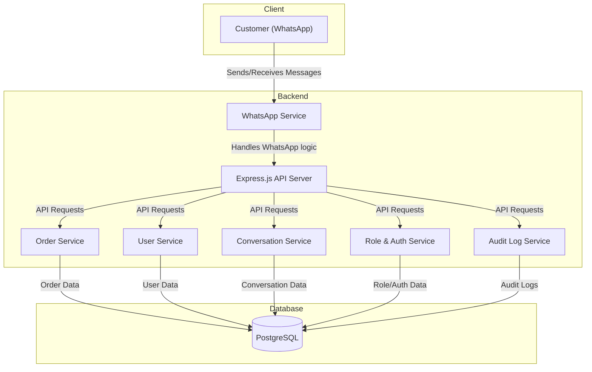

# Peekaboo Application

Peekaboo is a platform designed to streamline order management and customer communication, leveraging WhatsApp integration for real-time interactions. This repository contains the backend server and related resources.

## 🏛️ High-Level Architecture

### Key Components
- **Client**: Customers interact via WhatsApp, sending messages and receiving order updates.
- **Backend (Express.js API Server)**: Handles all business logic, API endpoints, and service orchestration.
  - **WhatsApp Service**: Manages WhatsApp message processing, order creation, and conversation flow.
  - **Order Service**: Handles order lifecycle, assignment, and tracking.
  - **User Service**: Manages user accounts, authentication, and roles.
  - **Conversation Service**: Tracks conversation state and message history.
  - **Role & Auth Service**: Provides role-based access control and authentication.
  - **Audit Log Service**: Logs critical actions for traceability.
- **Database (PostgreSQL)**: Stores all persistent data, including users, orders, conversations, roles, and logs.

## 📚 Backend Documentation

For detailed backend setup, features, and API documentation, see [server/README.md](server/README.md). 
