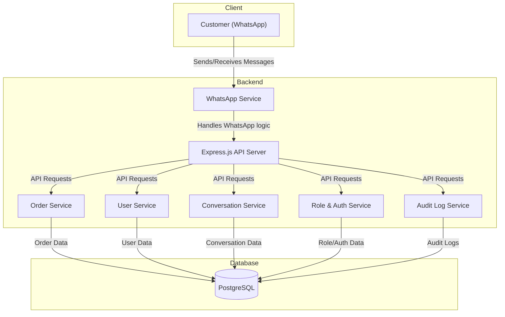

# Peekaboo Application

Peekaboo is a platform designed to streamline order management and customer communication, leveraging WhatsApp integration for real-time interactions. This repository contains the backend server and related resources.

## 🏛️ High-Level Architecture



### Key Components
- **Client**: Customers interact via WhatsApp, sending messages and receiving order updates.
- **Backend (Express.js API Server)**: Handles all business logic, API endpoints, and service orchestration.
  - **WhatsApp Service**: Manages WhatsApp message processing, order creation, and conversation flow.
  - **Order Service**: Handles order lifecycle, assignment, and tracking.
  - **User Service**: Manages user accounts, authentication, and roles.
  - **Conversation Service**: Tracks conversation state and message history.
  - **Role & Auth Service**: Provides role-based access control and authentication.
  - **Audit Log Service**: Logs critical actions for traceability.
- **Database (PostgreSQL)**: Stores all persistent data, including users, orders, conversations, roles, and logs.

## 🚀 Deployment

Use [scripts/deploy.sh](scripts/deploy.sh) to deploy the backend and web client together with PM2. The script supports Ubuntu/Debian Linux and macOS on both Apple Silicon and Intel chips.

### Server Assumptions

Before running the script, make sure:

- The repository has been cloned onto the server.
- The machine is running Ubuntu/Debian, or macOS on Apple Silicon (`arm64`) or Intel (`x86_64`).
- PostgreSQL is already installed, reachable, and configured for the values in `server/.env`.
- `server/.env` exists and contains the production backend configuration.
- `client/.env` exists and contains the Vite build-time client configuration, such as `VITE_API_BASE_URL`.
- On Linux, the deploy user can run `sudo` if Node.js, PM2, or base packages need to be installed.
- On macOS, run the script as a normal admin user, not as root. The script uses Homebrew and checks for Xcode Command Line Tools.

The script installs OS and Node tooling only. It does not configure nginx, SSL certificates, firewall rules, database provisioning, DNS, or secrets management.

### First-Time Deploy

From the repository root:

```bash
chmod +x scripts/deploy.sh
./scripts/deploy.sh
```

By default, the script:

- On Ubuntu/Debian, installs `curl`, `git`, `build-essential`, and `ca-certificates` with `apt-get`.
- On macOS, verifies Xcode Command Line Tools, installs or loads Homebrew from `/opt/homebrew` on Apple Silicon or `/usr/local` on Intel, and installs `git` if missing.
- Installs Node.js 20 from NodeSource on Linux or `node@20` from Homebrew on macOS if `node` or `npm` is missing.
- Installs PM2 globally if it is missing.
- Installs dependencies in `server/` and `client/` using `npm ci` when a lockfile exists.
- Builds the server and client.
- Starts or restarts PM2 processes named `peekaboo-server` and `peekaboo-client`.
- Saves the PM2 process list with `pm2 save`.

Default local service URLs:

- Backend: `http://localhost:8080`
- Client: `http://localhost:4173`

### Deploy Options

Update the checked-out branch before building:

```bash
GIT_PULL=true ./scripts/deploy.sh
```

Build the server and client one at a time on low-resource servers:

```bash
SEQUENTIAL=true ./scripts/deploy.sh
```

Override ports or runtime defaults:

```bash
PORT=8081 CLIENT_PORT=4174 NODE_ENV=production ./scripts/deploy.sh
```

Override Node.js major version or PM2 process names:

```bash
NODE_MAJOR=20 \
SERVER_PM2_NAME=peekaboo-api \
CLIENT_PM2_NAME=peekaboo-web \
./scripts/deploy.sh
```

Supported environment variables:

| Variable | Default | Purpose |
| --- | --- | --- |
| `NODE_MAJOR` | `20` | Node.js major version installed from NodeSource when Node is missing. |
| `NODE_ENV` | `production` | Runtime environment passed to PM2 processes. |
| `PORT` | `8080` | Backend server port. |
| `CLIENT_PORT` | `4173` | Vite preview port for the web client. |
| `SERVER_PM2_NAME` | `peekaboo-server` | PM2 process name for the backend. |
| `CLIENT_PM2_NAME` | `peekaboo-client` | PM2 process name for the web client. |
| `GIT_PULL` | `false` | Run `git pull --ff-only` before installing and building. |
| `SEQUENTIAL` | `false` | Build apps one after another instead of in parallel. |

### PM2 Operations

Useful PM2 commands after deployment:

```bash
pm2 status
pm2 logs peekaboo-server
pm2 logs peekaboo-client
pm2 restart peekaboo-server --update-env
pm2 restart peekaboo-client --update-env
pm2 save
```

The backend is started as a single PM2 process because `server/src/server.ts` already uses Node cluster internally. Do not enable PM2 cluster mode unless the backend clustering code is changed.

The client is served with `vite preview` under PM2. If you later move the web client behind nginx or another static host, update the deployment script and this section together.

## 📚 Backend Documentation

For detailed backend setup, features, and API documentation, see [server/README.md](server/README.md). 
