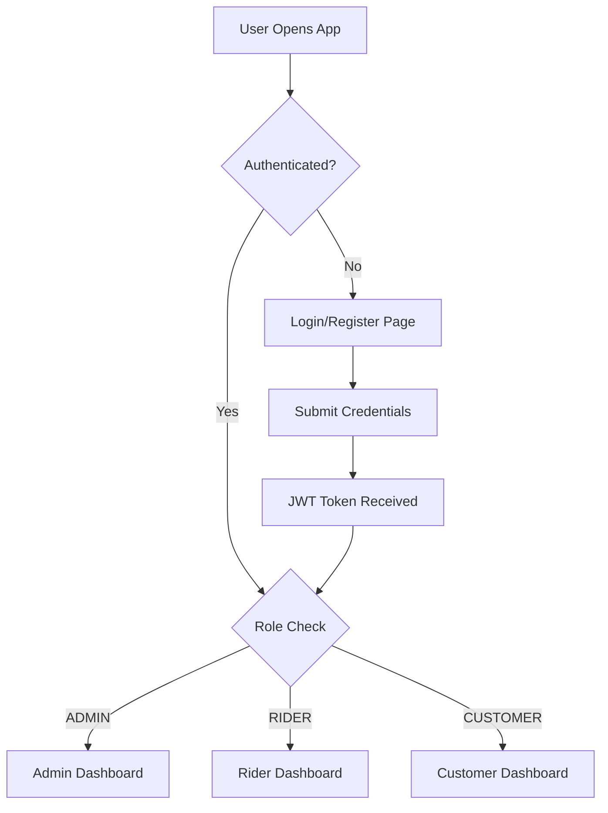
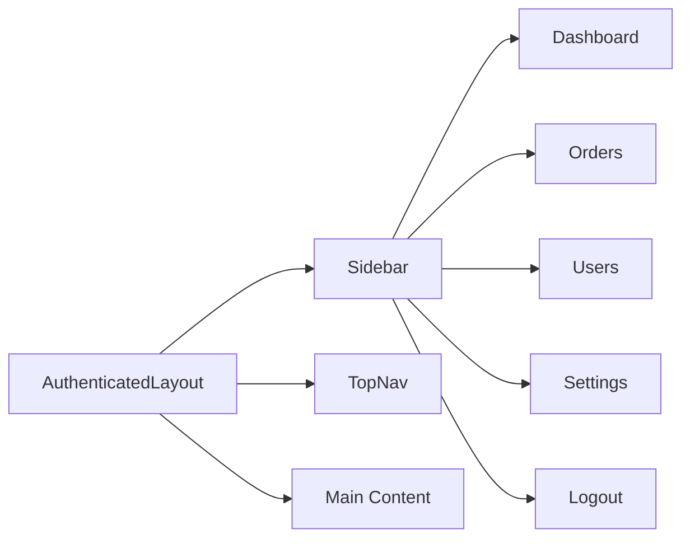
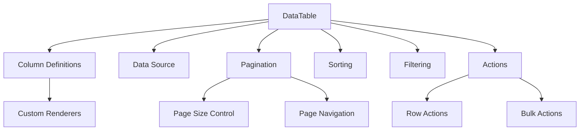
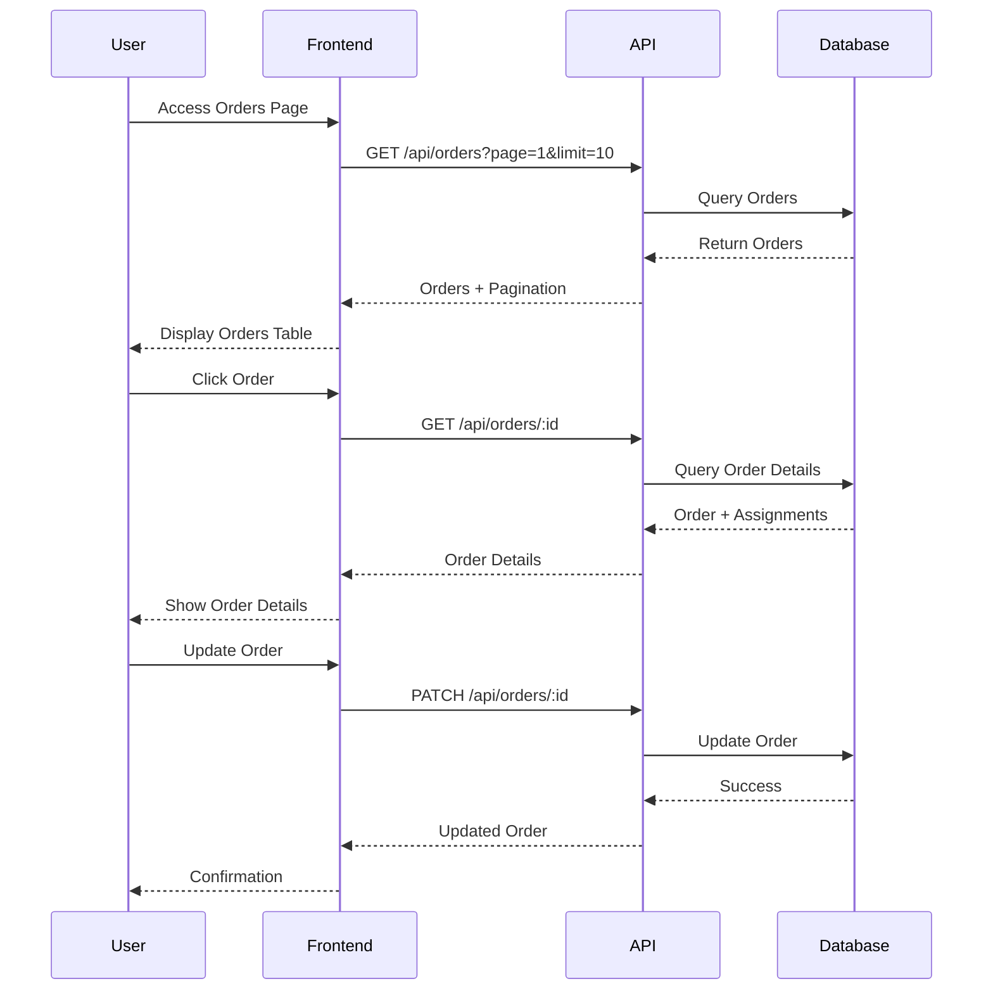
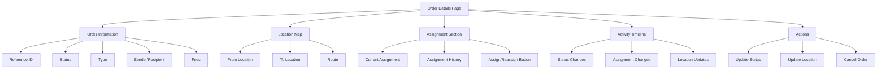
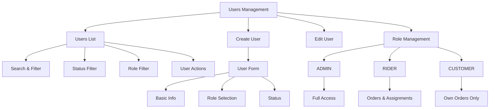
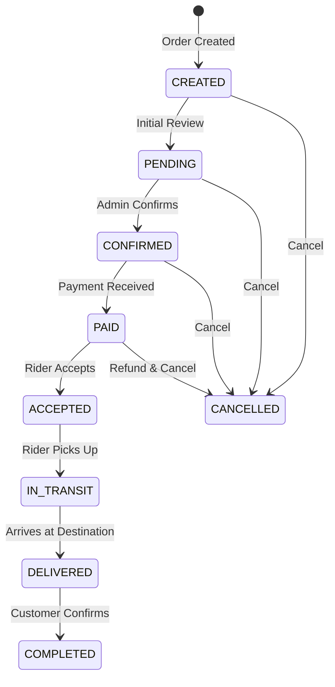
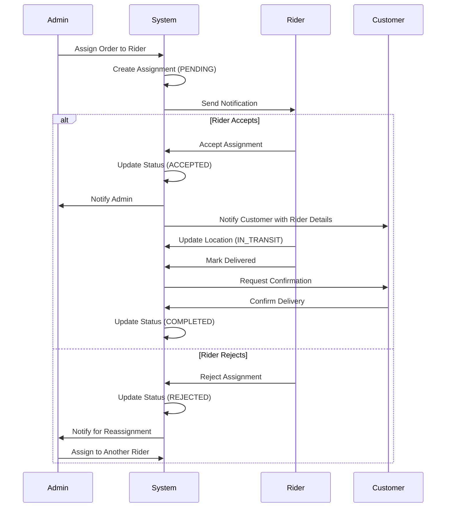

# Peekaboo Client - Frontend Application

A modern React + TypeScript + Vite application for the Peekaboo delivery management system, featuring order tracking, user management, and role-based access control.

## 🚀 Features

- **Authentication & Authorization**
  - User login and registration
  - JWT-based authentication
  - Role-based access control (CUSTOMER, RIDER, ADMIN)
  - Protected routes and layouts

- **Order Management**
  - Real-time order tracking
  - Order creation and updates
  - Assignment management
  - Location-based services with Google Maps integration

- **User Management**
  - User CRUD operations
  - Role assignment
  - Status management (ACTIVE, INACTIVE, SUSPENDED)

- **Modern UI/UX**
  - Responsive design with Tailwind CSS
  - shadcn/ui component library
  - Dark mode support
  - Interactive maps and location services

## 📋 Prerequisites

- Node.js (v18 or higher)
- npm or yarn
- Google Maps API key
- Backend API running

## 🛠️ Tech Stack

- **Framework**: React 19.1.1
- **Build Tool**: Vite 7.1.2
- **Language**: TypeScript 5.8.3
- **Routing**: React Router DOM 7.9.1
- **State Management**: Redux Toolkit 2.9.0
- **Styling**: Tailwind CSS 4.1.13
- **UI Components**: shadcn/ui + Radix UI
- **Maps**: @vis.gl/react-google-maps 1.5.5
- **Icons**: Font Awesome 7.0.1 + Lucide React
- **Forms**: React Hook Form 7.62.0
- **Notifications**: Sonner 2.0.7

## 📁 Project Structure

```
src/
├── components/          # Reusable components
│   ├── ui/             # shadcn/ui components
│   ├── inputs/         # Form inputs & controls
│   ├── modals/         # Modal dialogs
│   └── tables/         # Data table components
├── containers/         # Container components
│   ├── auth/           # Authentication components
│   ├── navigation/     # Navigation & layouts
│   ├── orders/         # Order-related containers
│   └── users/          # User management containers
├── pages/              # Page components
│   ├── auth/           # Auth pages (Login, Register)
│   ├── admin/          # Admin dashboard pages
│   │   ├── orders/     # Order management
│   │   └── users/      # User management
│   ├── public/         # Public pages
│   └── common/         # Shared pages (404, etc.)
├── hooks/              # Custom React hooks
│   ├── auth/           # Authentication hooks
│   ├── orders/         # Order hooks
│   └── users/          # User hooks
├── services/           # API services
│   ├── auth.service.ts
│   ├── order.service.ts
│   └── user.service.ts
├── states/             # Redux state management
│   ├── slices/         # Redux slices
│   └── store.ts        # Store configuration
├── types/              # TypeScript definitions
├── constants/          # App constants
├── utils/              # Utility functions
└── routes/             # Route definitions
```

## 🔐 Implementation Roadmap

### Phase 1: Authentication & Authorization ✅



**Tasks:**
1. Create authentication pages
   - [pages/auth/Login.tsx](src/pages/auth/Login.tsx)
   - [pages/auth/Register.tsx](src/pages/auth/Register.tsx)

2. Implement authentication service
   - [services/auth.service.ts](src/services/auth.service.ts)
   - JWT token management
   - Login/logout/register endpoints

3. Add auth state management
   - [states/slices/auth.slice.ts](src/states/slices/auth.slice.ts)
   - User session persistence
   - Token refresh logic

4. Create protected route wrapper
   - [routes/ProtectedRoute.tsx](src/routes/ProtectedRoute.tsx)
   - Role-based access control
   - Redirect to login if unauthenticated

### Phase 2: Authenticated Layout with Sidebar 🔨



**Implementation based on [shadcn sidebar block](https://ui.shadcn.com/blocks/sidebar):**

1. Install shadcn components:
```bash
npx shadcn@latest add sidebar
npx shadcn@latest add navigation-menu
npx shadcn@latest add dropdown-menu
npx shadcn@latest add avatar
npx shadcn@latest add separator
```

2. Create layout structure:
   - [containers/navigation/AuthenticatedLayout.tsx](src/containers/navigation/AuthenticatedLayout.tsx)
   - [components/navigation/AppSidebar.tsx](src/components/navigation/AppSidebar.tsx)
   - [components/navigation/TopNavBar.tsx](src/components/navigation/TopNavBar.tsx)

3. Sidebar features:
   - Collapsible sidebar
   - Role-based navigation items
   - Active route highlighting
   - User profile dropdown
   - Responsive mobile drawer

4. Navigation items:
```typescript
const navigationItems = [
  { label: 'Dashboard', href: '/admin', icon: LayoutDashboard, roles: ['ADMIN', 'RIDER'] },
  { label: 'Orders', href: '/admin/orders', icon: Package, roles: ['ADMIN', 'RIDER'] },
  { label: 'Users', href: '/admin/users', icon: Users, roles: ['ADMIN'] },
  { label: 'Assignments', href: '/admin/assignments', icon: ClipboardList, roles: ['ADMIN', 'RIDER'] },
  { label: 'Settings', href: '/admin/settings', icon: Settings, roles: ['ADMIN', 'RIDER', 'CUSTOMER'] },
]
```

### Phase 3: Reusable Data Table Component 📊



**Install required components:**
```bash
npx shadcn@latest add table
npx shadcn@latest add button
npx shadcn@latest add input
npx shadcn@latest add dropdown-menu
npx shadcn@latest add checkbox
```

**Implementation:**

1. Create reusable table component:
   - [components/tables/DataTable.tsx](src/components/tables/DataTable.tsx)

2. Features:
   - Generic TypeScript support
   - Server-side pagination
   - Column sorting
   - Search/filter
   - Row selection
   - Custom cell renderers
   - Action buttons (edit, delete, view)
   - Bulk actions
   - Loading states
   - Empty states

3. Usage example:
```typescript
interface DataTableProps<T> {
  data: T[];
  columns: ColumnDef<T>[];
  pageCount?: number;
  pageIndex?: number;
  pageSize?: number;
  onPageChange?: (page: number) => void;
  onPageSizeChange?: (size: number) => void;
  onSortChange?: (sort: SortConfig) => void;
  isLoading?: boolean;
  onRowClick?: (row: T) => void;
}
```

### Phase 4: Orders Management System 📦



**Implementation:**

1. Orders list page:
   - [pages/admin/orders/OrdersList.tsx](src/pages/admin/orders/OrdersList.tsx)
   - [hooks/orders/useOrders.ts](src/hooks/orders/useOrders.ts)

2. Column definitions:
```typescript
const orderColumns: ColumnDef<Order>[] = [
  { accessorKey: 'referenceId', header: 'Reference ID' },
  { accessorKey: 'type', header: 'Type', cell: ({ row }) => <Badge>{row.original.type}</Badge> },
  { accessorKey: 'status', header: 'Status', cell: ({ row }) => <OrderStatusBadge status={row.original.status} /> },
  { accessorKey: 'sender.name', header: 'Sender' },
  { accessorKey: 'recipient.name', header: 'Recipient' },
  { accessorKey: 'initialFee', header: 'Fee', cell: ({ row }) => formatCurrency(row.original.initialFee) },
  { accessorKey: 'createdAt', header: 'Created', cell: ({ row }) => formatDate(row.original.createdAt) },
  { id: 'actions', cell: ({ row }) => <OrderRowActions order={row.original} /> }
]
```

3. Filters and search:
   - Status filter (dropdown)
   - Type filter (SEND/RECEIVE)
   - Date range picker
   - Search by reference ID, sender, or recipient

4. Order service:
   - [services/order.service.ts](src/services/order.service.ts)
   - CRUD operations
   - Status updates
   - Assignment management

### Phase 5: Order Details & Assignment Management 🎯



**Implementation:**

1. Order details page:
   - [pages/admin/orders/OrderDetails.tsx](src/pages/admin/orders/OrderDetails.tsx)
   - [containers/orders/OrderDetailsContainer.tsx](src/containers/orders/OrderDetailsContainer.tsx)

2. Assignment management:
   - [components/orders/AssignmentSection.tsx](src/components/orders/AssignmentSection.tsx)
   - Assign rider modal
   - Reassign functionality
   - Assignment history table
   - Status tracking (PENDING, ACCEPTED, REJECTED, COMPLETED)

3. Components:
   - Order info card
   - Location map with route
   - Assignment timeline
   - Activity log
   - Quick actions toolbar

4. Install additional components:
```bash
npx shadcn@latest add card
npx shadcn@latest add badge
npx shadcn@latest add select
npx shadcn@latest add dialog
npx shadcn@latest add tabs
npx shadcn@latest add timeline
```

### Phase 6: User Management & RBAC 👥



**Implementation:**

1. Users management page:
   - [pages/admin/users/UsersList.tsx](src/pages/admin/users/UsersList.tsx)
   - [pages/admin/users/UserDetails.tsx](src/pages/admin/users/UserDetails.tsx)
   - [pages/admin/users/CreateUser.tsx](src/pages/admin/users/CreateUser.tsx)

2. User columns:
```typescript
const userColumns: ColumnDef<User>[] = [
  { accessorKey: 'name', header: 'Name' },
  { accessorKey: 'email', header: 'Email' },
  { accessorKey: 'phoneNumber', header: 'Phone' },
  {
    accessorKey: 'roles',
    header: 'Roles',
    cell: ({ row }) => <RoleBadges roles={row.original.roles} />
  },
  {
    accessorKey: 'status',
    header: 'Status',
    cell: ({ row }) => <UserStatusBadge status={row.original.status} />
  },
  { accessorKey: 'createdAt', header: 'Joined', cell: ({ row }) => formatDate(row.original.createdAt) },
  { id: 'actions', cell: ({ row }) => <UserRowActions user={row.original} /> }
]
```

3. User form components:
   - [components/users/UserForm.tsx](src/components/users/UserForm.tsx)
   - Basic information fields
   - Role selection (multi-select or single based on requirements)
   - Status management
   - Password management (create/reset)

4. Install form components:
```bash
npx shadcn@latest add form
npx shadcn@latest add label
npx shadcn@latest add input
npx shadcn@latest add select
npx shadcn@latest add switch
npx shadcn@latest add radio-group
```

5. RBAC implementation:
   - [hooks/auth/usePermissions.ts](src/hooks/auth/usePermissions.ts)
   - Permission checking utilities
   - Component-level access control
   - Route-level protection

6. User service:
   - [services/user.service.ts](src/services/user.service.ts)
   - Create, update, delete users
   - Role assignment
   - Status management
   - Password reset

## 🔄 Order Status Flow



## 📊 Assignment Workflow



## 🎨 Component Examples

### DataTable Component Usage

```tsx
import { DataTable } from '@/components/tables/DataTable';
import { useOrders } from '@/hooks/orders/useOrders';

export const OrdersList = () => {
  const { orders, isLoading, pageCount, filters, setFilters } = useOrders();

  return (
    <DataTable
      data={orders}
      columns={orderColumns}
      pageCount={pageCount}
      pageIndex={filters.page}
      pageSize={filters.limit}
      onPageChange={(page) => setFilters({ ...filters, page })}
      onPageSizeChange={(size) => setFilters({ ...filters, limit: size })}
      isLoading={isLoading}
    />
  );
};
```

### Authenticated Layout Usage

```tsx
import { AuthenticatedLayout } from '@/containers/navigation/AuthenticatedLayout';

// In Router.tsx
<Route element={<AuthenticatedLayout />}>
  <Route path="/admin/orders" element={<OrdersList />} />
  <Route path="/admin/orders/:id" element={<OrderDetails />} />
  <Route path="/admin/users" element={<UsersList />} />
</Route>
```

### Protected Route Example

```tsx
import { ProtectedRoute } from '@/routes/ProtectedRoute';

<Route
  path="/admin/users"
  element={
    <ProtectedRoute allowedRoles={['ADMIN']}>
      <UsersList />
    </ProtectedRoute>
  }
/>
```

## 🚀 Getting Started

1. **Clone and install:**
```bash
git clone <repository-url>
cd client
npm install
```

2. **Set up environment variables:**
```env
VITE_API_BASE_URL=http://localhost:5000/api
VITE_GOOGLE_MAPS_API_KEY=your_api_key_here
VITE_GOOGLE_MAPS_MAP_ID=your_map_id_here
```

3. **Install shadcn components:**
```bash
# Core components
npx shadcn@latest add button input label form
npx shadcn@latest add table card badge dialog
npx shadcn@latest add select dropdown-menu checkbox
npx shadcn@latest add sidebar navigation-menu
npx shadcn@latest add avatar separator tabs
```

4. **Run development server:**
```bash
npm run dev
```

5. **Build for production:**
```bash
npm run build
```

## 📝 Development Checklist

- [ ] Phase 1: Authentication & Authorization
  - [ ] Login page with form validation
  - [ ] Registration page with role selection
  - [ ] Auth service with JWT handling
  - [ ] Protected route wrapper
  - [ ] Auth state management

- [ ] Phase 2: Authenticated Layout
  - [ ] Sidebar component based on shadcn block
  - [ ] Top navigation bar
  - [ ] User profile dropdown
  - [ ] Role-based navigation items
  - [ ] Mobile responsive drawer

- [ ] Phase 3: Reusable DataTable
  - [ ] Generic table component
  - [ ] Pagination controls
  - [ ] Sorting functionality
  - [ ] Search and filters
  - [ ] Row actions menu

- [ ] Phase 4: Orders Management
  - [ ] Orders list page with DataTable
  - [ ] Order filters (status, type, date)
  - [ ] Order search functionality
  - [ ] Order CRUD operations
  - [ ] Status update actions

- [ ] Phase 5: Order Details & Assignments
  - [ ] Order details page
  - [ ] Location map with route
  - [ ] Assignment section
  - [ ] Activity timeline
  - [ ] Assign/reassign rider modal

- [ ] Phase 6: User Management
  - [ ] Users list with DataTable
  - [ ] Create user form
  - [ ] Edit user functionality
  - [ ] Role assignment
  - [ ] Status management
  - [ ] RBAC implementation

## 🔗 Related Documentation

- [shadcn/ui Documentation](https://ui.shadcn.com)
- [React Router v6](https://reactrouter.com)
- [Redux Toolkit](https://redux-toolkit.js.org)
- [React Hook Form](https://react-hook-form.com)
- [Tailwind CSS](https://tailwindcss.com)

## 📄 License

MIT
